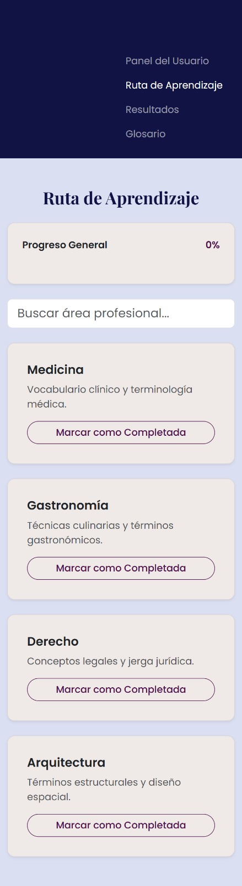
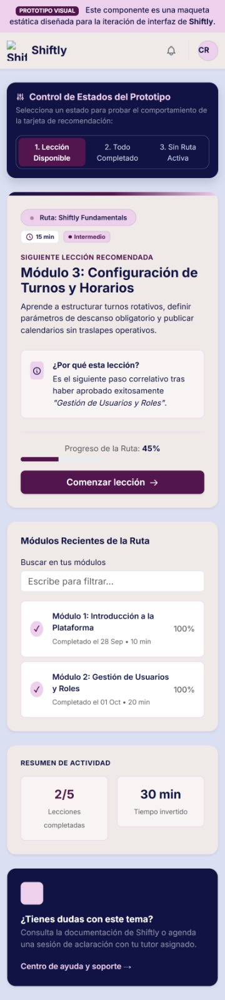
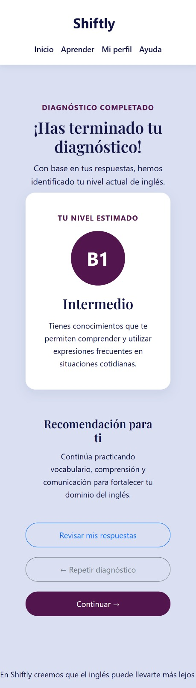
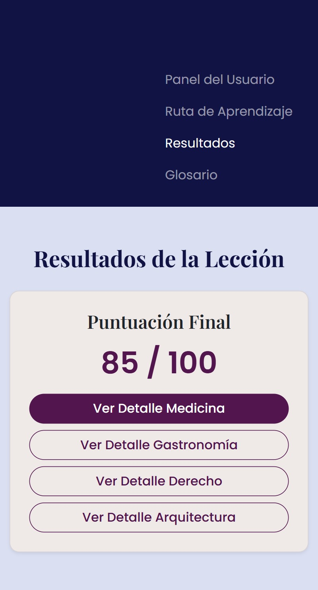

# Shiftly

Shiftly es una app web gamificada de inglés profesional que prepara a trabajadores para laborar en el extranjero. Enseña vocabulario técnico, jerga laboral e modismos corporativos complejos mediante lecciones interactivas, ayudando a los usuarios a comunicarse con total confianza y evitar malentendidos en su día a día.

---

## 👥 Integrantes del Equipo

- **Luis David Balandrano Delgado** — *Líder Técnico*
- **Keydhy Marelo Villa Aldana** — *Analista*
- **Isis Dayane Arellano Carrillo** — *Frontend*
- **Brian Jael Juárez Rodrigues** — *Frontend*
- **Julio Cesar Licona Hernandez** — *Backend*
- **Vanesa Lugo Ramírez** — *Backend*

---

## 📋 Descripción de la Aplicación

Shiftly brinda una experiencia de aprendizaje personalizada y gamificada. Permite a los usuarios seleccionar un área profesional de interés, evaluar su nivel mediante un test de diagnóstico inicial[cite: 3], realizar ejercicios prácticos iterativos[cite: 4], consultar un glosario con biblioteca de repaso por sectores y dar seguimiento a su racha y progreso dentro de un panel de control dedicado[cite: 2].

---

## 🎯 Objetivo

Desarrollar una plataforma web responsiva, accesible e interactiva construida con Bootstrap[cite: 1, 2, 3, 4] que facilite la capacitación en inglés técnico y corporativo, preparando profesionalmente a los trabajadores para desenvolverse sin barreras idiomáticas en el ámbito laboral extranjero.

---

## 🛠️ Tecnologías Utilizadas

- **HTML5:** Estructuración de páginas y componentes semánticos[cite: 1, 2, 3, 4].
- **CSS3 (Custom Styles):** Reglas de diseño personalizadas, variables CSS (`--color-primario`, `--color-secundario`, etc.) y ajustes tipográficos.
- **Bootstrap v5.3.3:** Framework de CSS para diseño adaptable (*Mobile-First*) y maquetación mediante *Grid System*[cite: 1, 2, 3, 4].
- **Bootstrap Icons v1.11.3:** Colección de iconografía para la interfaz de usuario[cite: 1].
- **Google Fonts:** Tipografías integradas (`Poppins` y `Playfair Display`)[cite: 4].
- **JavaScript (ES6+):** Scripts de interacción para selección de áreas y componentes dinámicos de Bootstrap[cite: 1, 2, 3].

---

## ⭐ Características Principales

- **Selección de Área Profesional:** Selección de contexto técnico (Programación, Gastronomía, Turismo, Negocios e Inglés Cotidiano).
- **Módulo de Diagnóstico:** Evaluación interactiva con cálculo del nivel B1 (Intermedio) y recomendaciones de estudio[cite: 3].
- **Práctica Gamificada e Interactiva:** Ejercicios dinámicos con banco de palabras, opción múltiple, emparejamiento y llenado de frases[cite: 4].
- **Dashboard de Aprendizaje:** Seguimiento de racha diaria, porcentaje de progreso general y desglose por área (Vocabulario, Gramática, Comprensión, Conversación)[cite: 2].
- **Biblioteca y Glosario por Sectores:** Tarjetas de repaso con ocultamiento de traducción (`<details>`), ejemplos de uso y soporte de pronunciación.
- **Módulo de Autenticación Completo:** Vistas para Inicio de Sesión, Registro, Recuperación de Contraseña y Verificación por Código de 4 Dígitos.
- **Página de Contacto e Integración Geográfica:** Mapa interactivo de ubicación embebido mediante Google Maps[cite: 1].
- **Perfil de Usuario:** Gestión de datos personales y estado de la cuenta.

---

## 🧩 Componentes de Bootstrap Utilizados

- **Navbar:** Menús de navegación superiores fijos (*sticky-top*) y colapsables con menú hamburguesa[cite: 1, 2].
- **Grid System (Rows & Cols):** Sistema de maquetación adaptable mediante contenedores y columnas (`row`, `col-lg-*`, `col-md-*`)[cite: 1, 2, 3, 4].
- **Cards:** Tarjetas contenedoras para estadísticas[cite: 2], preguntas de diagnóstico[cite: 3], ejercicios[cite: 4], tarjetas de vocabulario, perfiles y formularios[cite: 1].
- **Progress Bars:** Barras para la representación visual del avance en lecciones y métricas del dashboard[cite: 2, 3, 4].
- **Badges:** Identificadores y etiquetas de estado (*"USUARIO ACTIVO"*, *"Sector Técnico"*, *"Medicina & Salud"*).
- **Buttons & Button Groups:** Botones de acción directos, filtros con píldoras (`rounded-pill`) y variantes de contorno (`btn-outline-*`)[cite: 1, 2, 3].
- **Forms & Input Groups:** Formularios con iconos integrados en los campos de texto[cite: 1].

---

## 📁 Estructura del Proyecto

```text
Shiftly/
│
├── img_log/
│   └── logotipo interfaz.svg     # Logotipo oficial de la aplicación

│
├── img/                          # Capturas de las interfaces
│   ├── ruta-aprendizaje-por-areas.png
│   ├── ruta-aprendizaje-recomendacion.png
│   ├── resultados-diagnostico.png
│   └── resultados-leccion.png
│
├── index.html                    # Selección de área de aprendizaje
├── login.html                    # Formulario de inicio de sesión
├── registro.html                 # Registro de usuarios
├── recuperar-password.html        # Recuperación de acceso
├── verificacion-correo.html      # Confirmación por código de 4 dígitos
├── dashboard.html                # Panel de control y estadísticas del usuario
├── diagnostico.html              # Test de diagnóstico de nivel
├── resultado.html                # Resultado del diagnóstico inicial
├── Ejercicios.html               # Módulo interactivo de lecciones y ejercicios
├── resultados-leccion.html       # Desglose de puntuación al finalizar una lección
├── glosario.html                 # Biblioteca y repaso técnico por sectores
├── servicios.html                # Tarjetas de vocabulario técnico detallado
├── perfil.html                   # Configuración del perfil de usuario
├── contacto.html                 # Formulario de contacto y mapa interactivo
│
├── style.css                     # Hoja de estilos global y variables del proyecto
├── Style de ejercicios.css      # Estilos dedicados al módulo de ejercicios
└── README.md                     # Documentación del proyecto
---

## 🖼️ Capturas de la interfaz

Las capturas disponibles de las interfaces se guardan en `img/`:

- **Ruta de aprendizaje por áreas:** 
- **Ruta de aprendizaje con recomendación:** 
- **Resultados del diagnóstico:** 
- **Resultados de la lección:** 

